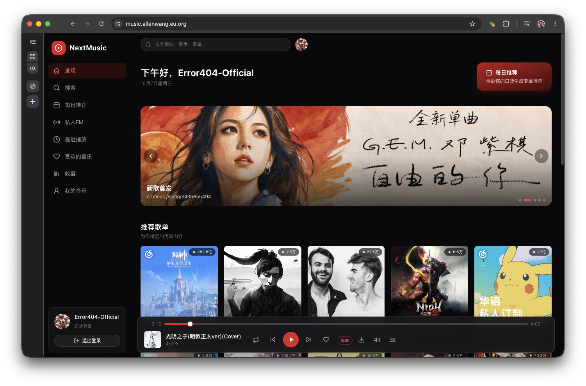

# NextMusic

基于网易云音乐的纯客户端音乐播放器：**Web（SPA）与桌面版（Electron，Windows / macOS / Linux）双形态**。无自建后端——Web 版直连自部署的主 NeteaseCloudMusicApi 兼容接口，桌面版内置本地运行 api-enhanced 服务；登录态与播放降级全部在客户端处理。



## 功能特性

- **发现**：Banner 轮播、推荐 / 个性化歌单、排行榜、热门歌手
- **搜索**：热搜榜与搜索建议，支持单曲 / 专辑 / 歌手 / 歌单
- **每日推荐、私人 FM**：FM 支持跳过（垃圾桶"不再播放"），队列耗尽自动续播（需登录）
- **浏览**：歌单 / 专辑 / 歌手 / 用户主页，歌手热门歌曲、专辑列表、简介与相似歌手
- **我的音乐**：喜欢的音乐、最近播放、收藏的专辑与歌手
- **播放器**：播放条与全屏播放页（歌词 + 翻译开关）、播放队列抽屉、顺序 / 单曲循环 / 随机三种播放模式
- **音质**：标准至超清母带共 10 档可选（部分为 VIP 档，能否生效取决于账号与音源）
- **解灰**：设置中可开关（默认开启，全平台可用），歌曲请求附带解灰参数，对 VIP/灰色歌曲尝试获取完整音频——主 API 需支持解灰（如 api-enhanced），不支持时自动回退试听片段
- **播放可靠性**：
  - 播放进度 ≥50% 时自动预缓存下一曲，命中后直接作为播放第 0 步
  - 播放降级链：主 API JSON 直链（解灰开启时附带 unblock 参数）→ 主 API `/song/url/v1/302`，预缓存命中则直接以缓存音频播放；加载失败或命中试听片段（时长过短）自动推进下一步
- **下载**：优先获取下载直链（blob 下载），失败回退浏览器新标签页；不属于写操作，各登录模式均可用
- **键盘快捷键**：空格 播放 / 暂停，← / → 切歌，Ctrl/⌘ + ↑ / ↓ 音量调节（输入框聚焦时不劫持）
- **登录与权限**：手机号 / 邮箱 / 扫码 / 游客 / 虚拟登录；游客与虚拟模式为只读，写操作（喜欢、收藏、歌单编辑、FM 垃圾桶）统一拦截并提示
- **桌面版（Electron）**：
  - 内置本地运行 api-enhanced，无需自部署远程 API 实例；也可在设置中覆盖为远程地址
  - 播放输出设备切换（扬声器 / 耳机，即时生效、设备拔出自动回退）
  - 登录态主进程文件持久化（免疫 Windows 下 localStorage 被杀软/权限清空的丢失问题）
  - 三平台分发：macOS dmg+zip、Windows 安装版 + 绿色版免安装、Linux AppImage / deb / rpm / pacman / flatpak / snap

## 技术栈
Vue 3 + TypeScript + Vite + Pinia + Tailwind CSS；测试使用 Vitest 与 Playwright。

## 快速开始

环境要求：Node.js（本地验证环境为 Node ≥ 22），npm。

```bash
# 1. 安装依赖
npm install

# 2. 配置环境变量（VITE_MAIN_API 必填）
cp .env.example .env.local

# 3. 启动开发服务器
npm run dev
```

### 环境变量

| 变量 | 必填 | 说明 |
| --- | --- | --- |
| `VITE_MAIN_API` | 是 | 主 API 地址（构建时注入），例如自部署的 NeteaseCloudMusicApi Enhanced 实例；缺失时运行时直接抛错 |

## 部署到 Vercel

[](https://vercel.com/new/clone?repository-url=https%3A%2F%2Fgithub.com%2Falanwang233233%2FNextMusic&env=VITE_MAIN_API&envDescription=%E4%B8%BB%20API%20%E6%9C%8D%E5%8A%A1%E5%99%A8%E5%9C%B0%E5%9D%80%EF%BC%8C%E4%BE%8B%E5%A6%82%20https%3A%2F%2Fyour-main-api.example.com&project-name=next-music&repository-name=NextMusic)

点击上方按钮即可一键克隆仓库并进入 Vercel 部署流程，或按以下步骤手动部署：

1. Fork 本仓库
2. 在 Vercel 控制台点击 **Add New → Project**，导入 fork 后的仓库
3. Framework Preset 会自动识别为 **Vite**（`vercel.json` 已配置构建命令）
4. 在 **Environment Variables** 中添加：
   - `VITE_MAIN_API` = 你的主 API 地址（必填，例如自部署的 NeteaseCloudMusicApi Enhanced 实例）
5. 点击 **Deploy**，构建完成后即可访问

> 注意：`VITE_MAIN_API` 是构建时变量，修改后需要重新触发部署才会生效。

## 桌面版（Electron）

从 [Releases](https://github.com/alanwang233233/NextMusic/releases) 下载对应平台安装包（由 GitHub Actions 在 `desktop-v*` 标签上自动构建发布）。安装包未签名：macOS 首次打开需右键 →「打开」（或到系统设置放行 Gatekeeper 拦截），Windows 会提示 SmartScreen（点「仍要运行」）。

桌面版在应用内嵌本地运行 [api-enhanced](https://github.com/NeteaseCloudMusicApiEnhanced/api-enhanced)（监听 `127.0.0.1` 随机端口），无需自部署远程实例；可在 **设置 → 桌面版** 中切换播放设备（扬声器/耳机）、覆盖主 API 为远程地址、开关解灰。纯 Web 版与部署流程完全不受影响。

```bash
# 桌面开发（vite dev + electron）
npm run desktop:dev

# 打包当前平台（未签名）
npm run desktop:build            # 透传参数，如 --dir 仅出未打包目录

# 显式指定平台
npm run desktop:build:mac        # dmg + zip（arm64/x64）
npm run desktop:build:win        # NSIS 安装包 + portable 绿色版免安装
npm run desktop:build:linux      # AppImage + deb + rpm + pacman + flatpak + snap
```

- 应用图标为占位生成（`scripts/generate-icon.mjs` → `assets/icon.png`），替换 `assets/icon.png` 即可（electron-builder 自动转 icns/ico）
- 推送 `desktop-v*` 标签触发 GitHub Actions 三平台构建并发布 Release（`.github/workflows/desktop.yml`）
- 桌面冒烟测试：`npx playwright test tests/e2e/desktop.smoke.spec.ts`（需先 `npm run build && npm run desktop:build:electron`；`DESKTOP_EXECUTABLE` 指向打包后可执行文件可验证 asar，`DESKTOP_NET_CHECK=1` 需外网）

## 可用脚本

| 命令 | 说明 |
| --- | --- |
| `npm run dev` | 启动开发服务器 |
| `npm run build` | 类型检查（`vue-tsc -b`）+ 生产构建，提交前必须通过 |
| `npm run typecheck` | 仅类型检查 |
| `npm run test` | Vitest 单元测试 + 组件测试 |
| `npm run test:unit` / `npm run test:components` | 分别运行单元 / 组件测试 |
| `npm run test:e2e` | Playwright E2E（需先 `npm run build`，跑的是 `vite preview` 服务的 `dist`） |
| `npm run desktop:dev` | 桌面开发（vite dev server + Electron） |
| `npm run desktop:build` / `desktop:build:mac\|win\|linux` | 桌面打包（强制置空 `VITE_MAIN_API`，Web 构建 → Electron esbuild → electron-builder） |
| `npm run typecheck:electron` | Electron 主进程/预加载类型检查（`tsc -p electron/tsconfig.json`） |
| `npm run test:visual` | 视觉截图测试（同样依赖最新 `dist`） |
| `npm run e2e:report` | 查看 Playwright 报告 |

## 架构概览

```
src/
├── api/          # 唯一网络层：主 API（mainApi）
├── player/       # 播放引擎（engine.ts）与下一曲预缓存（precache.ts）
├── stores/       # Pinia：auth / player / settings / toast
├── composables/  # 写操作守卫、全局键盘快捷键、播放设备管理等
├── components/   # layout / music / player / ui 组件；图标统一走 AppIcon 内联 SVG
├── views/        # 路由页面（发现、搜索、FM、歌单、专辑、歌手、登录等）
├── config/       # 音质档位、码率映射等常量
├── utils/        # 下载、格式化、歌词解析、桌面桥接检测
└── types/        # 领域模型
electron/src/     # 桌面版主进程（内嵌 api-enhanced）/ 预加载桥接
scripts/          # 桌面 dev/build 编排与占位图标生成
.github/workflows/desktop.yml  # 三平台桌面打包与 Release 发布
```

## 免责声明

本项目不是网易云官方项目，使用社区逆向接口，不受网易官方认可，接口随时失效，作者不保证可用或不封号。
本项目仅供学习交流使用，不存储任何音频文件；请支持正版音乐。使用本项目产生的所有账号风险、法律责任由使用者自行承担.
本项目禁止用于非法用途，使用时请务必遵守对应平台用户协议与版权法规。

## 开源许可

本项目基于 AGPL-3.0 license 许可进行开源。
AGPL-3.0 允许自由使用、修改与分发（包含商业场景），但修改后的衍生作品同样需要以 AGPL-3.0 协议开源。
